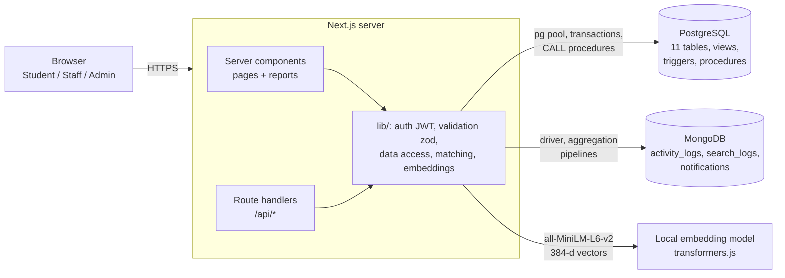

# Campus Lost & Found: Project Report

DBMS Experiential Learning, Level 3 Project, PES University

| | |
|---|---|
| Team | Pravith Mohandas (PES1UG24AM202), Vishnu Patruni (PES1UG24AM187) |
| Stack | Next.js 16 (App Router + Route Handlers), PostgreSQL 18, MongoDB 8, local AI embeddings |
| Databases | **SQL:** PostgreSQL. **NoSQL:** MongoDB. Embeddings are stored in PostgreSQL (`REAL[]`) |

---

## 1. Problem statement

Students lose things on campus every day: ID cards, earphones, bottles, chargers, calculators. Today they post on WhatsApp groups or ask at the security office. That process has three problems:

1. **Reports are scattered and unsearchable.** A found item handed in at the library is invisible to someone asking at the main gate.
2. **Descriptions never match exactly.** The owner says "AirPods case"; the finder writes "white earbuds box". Keyword search misses this.
3. **Ownership is hard to verify.** Anyone can say "that's mine". Staff need evidence, and repeat false claimers need to be spotted.

## 2. Objectives

- One place to report lost and found items, with photos, categories, campus locations and collection points.
- **Automatic matching** of lost reports to found items using both text similarity and AI meaning (sentence embeddings).
- A **verified claim workflow**: secret ownership questions, automatic answer scoring, staff approval, and a recorded physical handover.
- Role-based access for **students, staff (security/library desk) and admins**.
- Reports that help the administration: recovery rates, hotspots, department statistics, claim turnaround, fraud signals and unmet search demand.

## 3. Scope

**In scope:** reporting, moderation, search (keyword + semantic), match suggestions, claims, handovers, notifications, audit trail, admin reports, user management.

**Out of scope (future work):** email/SMS delivery of notifications, image-based similarity, mobile app, integration with the university ID system.

## 4. Functional requirements

| # | Requirement | Role |
|---|---|---|
| F1 | Register with SRN and department; sign in/out | Student |
| F2 | Report a lost item (title, description, category, place, date, colour, brand, photo) | Student, Staff |
| F3 | Report a found item, choose the collection point, optionally set a secret ownership question | Student, Staff |
| F4 | Moderate new reports (approve / reject) | Staff, Admin |
| F5 | Browse and filter reports; search by meaning (AI) or by exact words | Everyone |
| F6 | See suggested matches for my lost items; dismiss wrong suggestions | Student |
| F7 | Claim a found item with proof and the answer to the ownership question | Student |
| F8 | Review claims with an automatic answer-match score and the claimant's history; approve/reject | Staff, Admin |
| F9 | Record the handover; finder earns reputation points | Staff, Admin |
| F10 | In-app notifications for matches, claim decisions and handovers | All |
| F11 | Reports dashboard with charts and CSV export | Staff, Admin |
| F12 | Manage users (promote to staff, deactivate) and view the audit log | Admin |
| F13 | Close reports that are past their category's retention period | Staff, Admin |

## 5. System architecture



- Every write goes through a route handler in `app/api`, which validates input with **zod**, checks the session and role, and runs SQL in a **transaction** (`lib/db.js → withTransaction`).
- The acting user id is put in the transaction with `set_config('app.user_id', …)`, so the **audit trigger** knows who made each change.
- Credentials live in `.env.local` (git-ignored). Passwords are hashed with **bcrypt**; sessions are signed **JWT** in an httpOnly cookie.

## 6. Database choice and justification

| Data | Store | Why |
|---|---|---|
| Users, items, claims, matches, handovers, categories, locations, departments | **PostgreSQL** | Highly relational and must stay consistent: a claim must point at a real found item, only one claim per item may be approved, approving a claim must update several tables atomically. That needs foreign keys, CHECK constraints, triggers and ACID transactions. |
| Item embeddings (384 floats) | **PostgreSQL** `REAL[]` + `cosine_similarity()` SQL function | Keeps the vector next to the row it describes, so matching runs inside one SQL query that also filters by category, date window and status. (Can be moved to `pgvector` later without changing the app.) |
| Activity logs, search logs | **MongoDB** | Append-only, high-volume event data whose fields differ per event type (`view_item` has an itemId, `search` has filters, `login` has neither). No joins needed. A TTL index expires old search logs automatically. Aggregation pipelines answer "what do students search for that nobody has handed in?" |
| Notifications | **MongoDB** | Per-user inbox documents with a different `data` payload per type, read by one indexed query (`userId, read, createdAt`). |

If MongoDB is down, the app keeps working (logs/notifications are skipped with a warning), because PostgreSQL is the source of truth.

## 7. ER diagram


`AUDIT_LOG` is written only by triggers and has no foreign keys on purpose: it must keep history even after a record is deleted.

## 8. Relational schema

Primary keys are in **bold**; foreign keys are marked with →.

- departments(**dept_id**, code, name)
- users(**user_id**, srn, name, email, phone, password_hash, role, dept_id → departments, reputation, is_active, created_at, last_login_at)
- categories(**category_id**, name, is_high_value, retention_days)
- locations(**location_id**, building, area, is_collection_point)
- items(**item_id**, reporter_id → users, category_id → categories, location_id → locations, storage_location_id → locations, report_type, title, description, color, brand, event_date, status, embedding, search_doc, created_at, updated_at)
- item_images(**image_id**, item_id → items, image_url, uploaded_at)
- verification_questions(**question_id**, item_id → items, question, expected_answer)
- claims(**claim_id**, item_id → items, claimant_id → users, lost_item_id → items, proof_details, answer, verification_score, status, reviewed_by → users, review_note, created_at, reviewed_at)
- matches(**match_id**, lost_item_id → items, found_item_id → items, score, text_score, semantic_score, status, created_at)
- handovers(**handover_id**, claim_id → claims, handled_by → users, location_id → locations, handed_over_at, notes)
- audit_log(**log_id**, table_name, record_id, action, changed_by, old_data, new_data, changed_at)

All tables are in **3NF**: every non-key attribute depends only on the key. Denormalised reads are done with views (`v_item_details`), not by copying columns.

## 9. Data dictionary (constraints)

| Table | Constraint | Rule |
|---|---|---|
| users | `chk_user_email` | email matches `^[^@\s]+@[^@\s]+\.[^@\s]+$` |
| users | `chk_user_role` | role ∈ {student, staff, admin} |
| users | `chk_student_srn` | a student must have an SRN |
| users | `chk_reputation` | reputation ≥ 0 |
| users | UNIQUE | email, srn |
| categories | `chk_retention` | retention_days between 7 and 365 |
| locations | `uq_location` | (building, area) unique |
| items | `chk_item_type` | report_type ∈ {lost, found} |
| items | `chk_item_status` | status ∈ {pending, open, matched, claimed, returned, closed, rejected} |
| items | `chk_item_storage` | only found items have a storage location |
| items | `chk_embedding` | embedding is NULL or exactly 384 values |
| items | trigger `items_validate` | no future dates; storage must be a collection point; only legal status transitions |
| claims | `uq_claim_once` | one claim per (item, claimant) |
| claims | `ux_one_approved_claim` | partial unique index: one **approved** claim per item |
| claims | `chk_claim_review` | approved/rejected claims must have a reviewer and time |
| claims | trigger `claims_validate` | only open found items; not your own item; linked lost report must be yours; computes verification_score |
| matches | `chk_match_pair` | lost_item_id ≠ found_item_id |
| handovers | UNIQUE claim_id | one handover per claim |

Item status flow enforced by `trg_validate_item`:

```
pending ──► open ──► matched ──► claimed ──► returned
   │          │  ◄──────┘           │
   ▼          ▼                     ▼
rejected    closed ◄──► open       open (claim revoked)
```

## 10. NoSQL data model (MongoDB)

All three collections have a `$jsonSchema` **validator**, so MongoDB rejects malformed documents.

```js
// search_logs   (TTL index: removed after 365 days)
{ query: "black headphones", mode: "semantic", resultCount: 3, topScore: 0.81,
  filters: { type: "found" }, userId: 4, ts: ISODate() }

// activity_logs (index: { userId: 1, ts: -1 }, { action: 1, ts: -1 })
{ action: "view_item", userId: 4, role: "student", meta: { itemId: 18 }, ts: ISODate() }

// notifications (index: { userId: 1, read: 1, createdAt: -1 })
{ userId: 4, type: "match_found", title: "Possible match for \"Grey Wildcraft backpack\"",
  body: "...", link: "/items/18", read: false, data: { lostItemId: 17, foundItemId: 18, score: 1 },
  createdAt: ISODate() }
```

Aggregation pipelines (in `lib/mongo.js`, shown on the Reports page):
- **Most searched items:** `$match` last 30 days → `$group` by query → `$sort` → `$limit`.
- **Searches with no results:** `$match {resultCount: 0}` → `$group` → shows demand nobody has met.
- **Daily activity:** `$group` by `$dateToString` with `$addToSet` to count unique users.
- **Activity by role:** two-stage `$group` + `$arrayToObject`.

## 11. Semantic search and matching

| Question | Answer |
|---|---|
| What is embedded? | `title. brand. colour. description` of each item, and the user's search text |
| Model | `Xenova/all-MiniLM-L6-v2` (sentence-transformers), run locally with transformers.js. No API key, no cost |
| Vector | 384 floats, L2-normalised, stored in `items.embedding REAL[]` |
| Similarity metric | Cosine similarity, implemented as the SQL function `cosine_similarity(a, b)` |
| Retrieval | Search: rank items by cosine similarity to the query vector (threshold 0.3). Matching: `fn_find_matches(item)` |

`fn_find_matches` combines four signals inside one SQL query:

```
text_score     = 0.6 × trigram similarity(title+brand+colour) + 0.4 × full-text rank
semantic_score = cosine(embedding_lost, embedding_found)
score          = 0.65 × semantic + 0.35 × text  + bonuses (same place +0.08, brand +0.08, colour +0.04)
```

Candidates must be the opposite type, the same category, still open, and within the category's retention window. `sp_refresh_matches` stores suggestions with score ≥ 0.50 and notifies the lost item's owner. On the seed data this pairs every true lost/found pair and rejects a hoodie vs. watch false positive (0.45).

## 12. Advanced database features used

| Feature | Where |
|---|---|
| Transactions | `withTransaction()` around every write; `sp_approve_claim` approves one claim, rejects the others, updates two items and the matches atomically (demo in `06_demo_queries.sql` §9) |
| Stored procedures | `sp_approve_claim`, `sp_reject_claim`, `sp_record_handover`, `sp_refresh_matches` |
| Functions | `cosine_similarity`, `fn_find_matches` (returns a table), `fn_expire_stale_items` |
| Triggers | `items_validate`, `claims_validate`, `items_set_updated_at`, audit triggers on items/claims/users |
| Views | `v_item_details`, `v_category_stats`, `v_location_hotspots`, `v_department_stats`, `v_claim_turnaround` |
| Materialised view | `mv_monthly_trends` (refreshed by the housekeeping action) |
| Indexing | B-tree on filters, **GIN** on the full-text `search_doc`, **GIN trigram** on titles, **partial unique** index for one approved claim |
| Full-text search | generated `tsvector` column with weights (title A, description B), `websearch_to_tsquery`, `ts_rank` |
| Fuzzy search | `pg_trgm` `similarity`, `word_similarity`, `%` operator |
| Window functions | `RANK()` / `DENSE_RANK()` in reports |
| NoSQL aggregation | four MongoDB pipelines |
| Vector similarity search | embeddings + cosine similarity |

## 13. Important queries (reports)

All report SQL lives in [`sql/05_reports.sql`](../sql/05_reports.sql); the app reads that file directly, so the documentation and the app can never disagree. The Reports page shows each query's SQL under "Show SQL".

| Report | Concepts |
|---|---|
| Recovery rate by category | view, `COUNT(*) FILTER`, `NULLIF`, percentage |
| Department-wise lost items and average recovery time | 5-table LEFT JOIN, `AVG` of interval |
| Location hotspots | `GROUP BY` + `HAVING`, `RANK()` |
| Monthly lost vs found trend | materialised view, `date_trunc` |
| Average claim decision time by category | `AVG/MIN/MAX` |
| Most honest finders | correlated subquery, `DENSE_RANK()` |
| High-value items unclaimed for 7+ days | `NOT EXISTS`, date arithmetic |
| Users with repeatedly rejected claims | `HAVING COUNT(*) FILTER (…) >= 2` |
| Match quality | aggregates over the matches table |

## 14. Security

- Passwords: bcrypt (cost 10). Never logged; stripped from the audit log by the trigger.
- Sessions: HS256 JWT in an httpOnly, SameSite=Lax cookie; the account's active flag and role are re-checked on every write.
- SQL injection: every query uses parameters (`$1, $2`). The search builder only concatenates fixed SQL fragments.
- Configuration in environment variables (`.env.local`, git-ignored; `.env.example` committed).
- Validation in three layers: HTML form attributes, zod on the server, and constraints/triggers in the database.
- Uploads: only JPG/PNG/WebP up to 3 MB, saved under random UUID names.
- Secret ownership answers are only shown to staff, never to claimants.

## 15. Testing results

Run on 24 Oct 2026 against a fresh `npm run db:setup`.

| # | Test | Expected | Result |
|---|---|---|---|
| 1 | Sign in with correct demo password | session cookie, role returned | Pass |
| 2 | Sign in with wrong password | "Email or password is incorrect" | Pass |
| 3 | Report with 2-char title and future date | rejected with a field message | Pass |
| 4 | Student reports lost "Blue Casio digital watch" | saved as `pending` | Pass |
| 5 | Student tries to approve a report | 403 "Only staff can moderate reports" | Pass |
| 6 | Staff approves the lost and found watch reports | both `open`, 1 new match (AI score 0.92) | Pass |
| 7 | Finder claims their own found item | trigger error "You cannot claim an item you reported as found" | Pass |
| 8 | Owner claims with the correct answer | claim created, verification score 1.00 | Pass |
| 9 | Same owner claims again | "You have already claimed this item" (unique constraint) | Pass |
| 10 | Student tries to approve the claim | 403 | Pass |
| 11 | Staff approves the claim | both items `claimed`, match `confirmed` | Pass |
| 12 | Approve the same claim again | "Claim 18 is already approved" (procedure) | Pass |
| 13 | Record handover, then record it again | items `returned`, finder +10; second call rejected | Pass |
| 14 | Housekeeping | 1 expired report closed | Pass |
| 15 | Audit log | every change recorded with the acting user | Pass |
| 16 | Notifications | approved, match found, claim approved, collected | Pass |
| 17 | Semantic search "earphones" | finds "AirPods Pro case", "White Apple earbuds case" | Pass |
| 18 | `06_demo_queries.sql` failing statements | each blocked by the intended trigger/constraint | Pass |
| 19 | Transaction with ROLLBACK | claim back to `pending` | Pass |
| 20 | `next build` | all routes compile | Pass |
| 21 | Mobile width 375 px | no horizontal scroll | Pass |

## 16. Application screenshots

Add screenshots to `docs/screenshots/` before submission: home, browse/search, item page with matches, report form, dashboard, desk, reports, audit log.

## 17. Conclusion and future enhancements

The project combines a strictly consistent relational core (constraints, triggers, procedures and transactions keep claims and handovers correct) with MongoDB for flexible, high-volume event data, plus AI embeddings that let the database match items by meaning rather than by exact words.

Future work:
- Move embeddings to `pgvector` with an HNSW index once the item count grows.
- Image similarity (CLIP embeddings of uploaded photos).
- Email / push delivery of notifications.
- QR-code tags printed for every found item at the collection point.
- Campus heat-map of hotspots.
