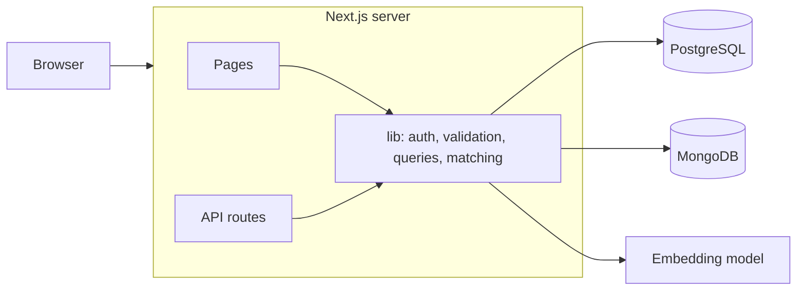
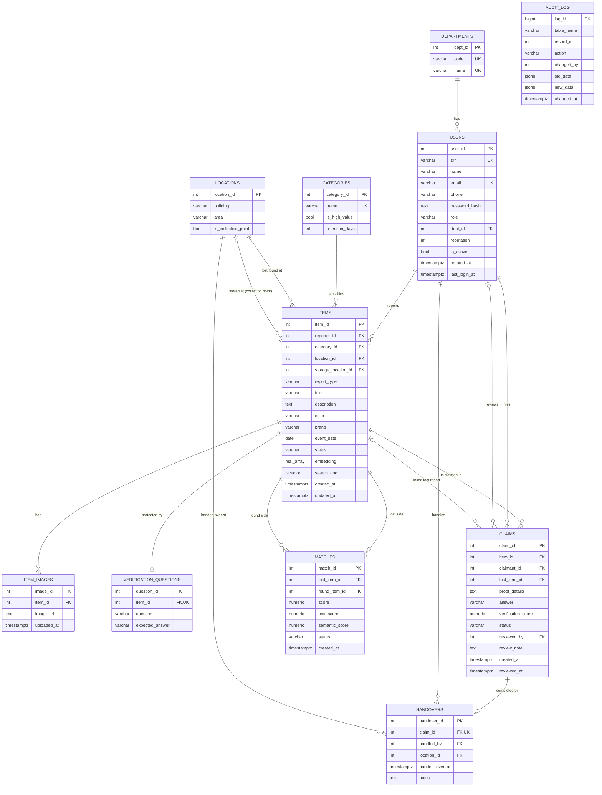

# Campus Lost & Found: Project Report

DBMS Experiential Learning, Level 3 Project, PES University

Team: Pravith Mohandas (PES1UG24AM202), Vishnu Patruni (PES1UG24AM187)

Stack: Next.js 16, PostgreSQL 18, MongoDB 8. Item embeddings are stored in PostgreSQL.

## 1. Problem statement

Things get lost on campus every day: ID cards, earphones, water bottles, chargers, calculators. At the moment students post about them in WhatsApp groups or ask at the security office. Messages get buried quickly, an item handed in at the library is invisible to someone asking at the main gate, and staff have no reliable way to check that the person claiming an item actually owns it.

There is also a wording problem. The owner might write "AirPods case" while the finder writes "white earbuds box", and a plain keyword search won't connect the two.

## 2. Objectives

- Give the campus one place to report lost and found items, with categories, locations, photos and collection points.
- Suggest likely lost/found pairs automatically, using both text similarity and similarity of meaning.
- Make claiming safer: let the finder set an ownership question, score the claimant's answer, and have staff approve the claim and record the handover.
- Support three roles: student, staff (security and library desk) and admin.
- Give the administration useful reports, such as recovery rate per category, where things get lost most, and which users keep making rejected claims.

## 3. Scope

In scope: reporting, moderation, keyword and meaning-based search, match suggestions, claims, handovers, in-app notifications, an audit trail, reports, and user management.

Not in scope for now: email or SMS notifications, matching by photo, a mobile app, and integration with the university's ID system.

## 4. Functional requirements

| # | Requirement | Who |
|---|---|---|
| F1 | Register with SRN and department, sign in and out | Student |
| F2 | Report a lost item with title, description, category, place, date, colour, brand and photo | Student, staff |
| F3 | Report a found item, pick the collection point, and optionally set an ownership question | Student, staff |
| F4 | Approve or reject new reports | Staff, admin |
| F5 | Browse and filter reports, and search by meaning or by exact words | Everyone |
| F6 | See suggested matches for my lost items and hide wrong ones | Student |
| F7 | Claim a found item with proof and an answer to the ownership question | Student |
| F8 | Review claims with the answer score and the claimant's history, then approve or reject | Staff, admin |
| F9 | Record the handover; the finder gets reputation points | Staff, admin |
| F10 | Notifications for matches, claim decisions and handovers | Everyone |
| F11 | Reports page with charts and CSV download | Staff, admin |
| F12 | Manage users and view the audit log | Admin |
| F13 | Close reports that are older than their category's retention period | Staff, admin |

## 5. System architecture



The browser talks only to the Next.js server. Pages read data on the server, and every change goes through an API route under `app/api`. Each route checks who is signed in and what role they have, validates the input with zod, and runs its SQL inside a transaction. The transaction also stores the current user's id with `set_config('app.user_id', ...)`, which is how the audit trigger knows who made a change.

Database credentials and the session secret live in `.env.local`, which is not committed. Passwords are hashed with bcrypt, and sessions are signed JWTs kept in an httpOnly cookie.

## 6. Choice of databases

PostgreSQL holds the core data: users, items, claims, matches, handovers, categories, locations and departments. This data is closely linked and has to stay consistent. A claim must point to a real found item, only one claim per item can be approved, and approving a claim changes several tables at once. Foreign keys, CHECK constraints, triggers and transactions handle all of that.

The item embeddings (384 numbers each) are also kept in PostgreSQL, as a `REAL[]` column, with a SQL function for cosine similarity. Keeping them next to the item means one query can filter by category, date and status and rank by similarity at the same time. If the data grows, the column can be moved to the pgvector extension without changing the app.

MongoDB holds activity logs, search logs and notifications. These are written far more often than they are read, each kind of event carries different fields (a search has filters, a page view has an item id, a login has neither), and nothing needs to be joined. A TTL index deletes old search logs automatically, and aggregation pipelines produce the search and activity reports.

If MongoDB is down the site still works. It just skips logging and notifications, because PostgreSQL is the source of truth.

## 7. ER diagram

An image version is in [ER_Diagram.svg](ER_Diagram.svg).



The audit log deliberately has no foreign keys, so its history survives when the original row is deleted.

## 8. Relational schema

Primary keys are in bold. FK means foreign key.

- departments(**dept_id**, code, name)
- users(**user_id**, srn, name, email, phone, password_hash, role, dept_id FK departments, reputation, is_active, created_at, last_login_at)
- categories(**category_id**, name, is_high_value, retention_days)
- locations(**location_id**, building, area, is_collection_point)
- items(**item_id**, reporter_id FK users, category_id FK categories, location_id FK locations, storage_location_id FK locations, report_type, title, description, color, brand, event_date, status, embedding, search_doc, created_at, updated_at)
- item_images(**image_id**, item_id FK items, image_url, uploaded_at)
- verification_questions(**question_id**, item_id FK items, question, expected_answer)
- claims(**claim_id**, item_id FK items, claimant_id FK users, lost_item_id FK items, proof_details, answer, verification_score, status, reviewed_by FK users, review_note, created_at, reviewed_at)
- matches(**match_id**, lost_item_id FK items, found_item_id FK items, score, text_score, semantic_score, status, created_at)
- handovers(**handover_id**, claim_id FK claims, handled_by FK users, location_id FK locations, handed_over_at, notes)
- audit_log(**log_id**, table_name, record_id, action, changed_by, old_data, new_data, changed_at)

The tables are in third normal form. Where a page needs data from several tables, we use a view (`v_item_details`) instead of copying columns.

## 9. Data dictionary and constraints

The full column definitions are in [`sql/01_schema.sql`](../sql/01_schema.sql). The main rules are:

| Table | Rule | How it's enforced |
|---|---|---|
| users | email must look like an email | CHECK `chk_user_email` |
| users | role is student, staff or admin | CHECK `chk_user_role` |
| users | students must have an SRN | CHECK `chk_student_srn` |
| users | email and SRN are unique | UNIQUE |
| categories | retention period is 7 to 365 days | CHECK `chk_retention` |
| locations | no duplicate building and area | UNIQUE `uq_location` |
| items | type is lost or found; status is one of seven values | CHECK |
| items | only found items have a storage location | CHECK `chk_item_storage` |
| items | an embedding has exactly 384 values | CHECK `chk_embedding` |
| items | no future dates, storage must be a collection point, only allowed status changes | trigger `items_validate` |
| claims | one claim per person per item | UNIQUE `uq_claim_once` |
| claims | only one approved claim per item | partial unique index `ux_one_approved_claim` |
| claims | approved or rejected claims must record who reviewed them and when | CHECK `chk_claim_review` |
| claims | only open found items can be claimed, not by the finder, and a linked lost report must be the claimant's own | trigger `claims_validate` |
| matches | an item can't be matched with itself | CHECK `chk_match_pair` |
| handovers | one handover per claim | UNIQUE |

An item's status can only move in these directions (checked by the `items_validate` trigger):

- pending to open or rejected
- open to matched, claimed, closed or rejected
- matched to open, claimed or closed
- claimed to returned, or back to open
- closed back to open

## 10. MongoDB data model

Each collection has a `$jsonSchema` validator, so MongoDB rejects documents that don't have the required fields.

```js
// search_logs (old entries are removed after a year by a TTL index)
{ query: "black headphones", mode: "semantic", resultCount: 3, topScore: 0.81,
  filters: { type: "found" }, userId: 4, ts: ISODate() }

// activity_logs (indexed on userId + ts and on action + ts)
{ action: "view_item", userId: 4, role: "student", meta: { itemId: 18 }, ts: ISODate() }

// notifications (indexed on userId + read + createdAt)
{ userId: 4, type: "match_found", title: "Possible match for \"Grey Wildcraft backpack\"",
  body: "...", link: "/items/18", read: false,
  data: { lostItemId: 17, foundItemId: 18, score: 1 }, createdAt: ISODate() }
```

The reports page runs four aggregation pipelines (in `lib/mongo.js`):

- most searched terms in the last 30 days (`$match`, `$group`, `$sort`, `$limit`)
- searches that returned nothing, which shows what people are looking for that nobody has handed in
- daily activity and the number of distinct users per day (`$dateToString`, `$addToSet`)
- activity broken down by role and action (two `$group` stages and `$arrayToObject`)

## 11. Matching and semantic search

For each item we join the title, brand, colour and description into one piece of text and turn it into a 384-number vector with the all-MiniLM-L6-v2 model. The model runs locally through transformers.js. The vectors are normalised and stored in `items.embedding`, and two vectors are compared with cosine similarity, written as the SQL function `cosine_similarity(a, b)`.

Search by meaning embeds the user's search text the same way and ranks items by cosine similarity, keeping anything above 0.3.

Matching is done by `fn_find_matches(item_id)`. It only looks at reports of the opposite type, in the same category, still open, and within the category's retention period. For each candidate it works out:

- a text score: 0.6 × trigram similarity of title, brand and colour, plus 0.4 × the full-text rank (multiplied by 3 and capped at 1, because raw ranks are small)
- a meaning score: the cosine similarity of the two embeddings
- a final score: 0.65 × meaning + 0.35 × text, plus a small bonus for the same place (0.08), same brand (0.08) or same colour (0.04)

`sp_refresh_matches` saves candidates scoring 0.50 or more. We picked 0.50 after testing on the sample data: every real pair scored at least 0.54, and the closest wrong pair (a black hoodie and a black watch) scored 0.45.

## 12. Advanced database features

- Transactions: every write runs inside one. For example, `sp_approve_claim` approves a claim, rejects the other claims on the item, updates both items and updates the matches; if any step fails, nothing is saved. Section 9 of `06_demo_queries.sql` shows this with a ROLLBACK.
- Stored procedures: `sp_approve_claim`, `sp_reject_claim`, `sp_record_handover`, `sp_refresh_matches`.
- Functions: `cosine_similarity`, `fn_find_matches` (returns a table), `fn_expire_stale_items`.
- Triggers: item and claim validation, `updated_at` maintenance, and audit logging on items, claims and users.
- Views: `v_item_details`, `v_category_stats`, `v_location_hotspots`, `v_department_stats`, `v_claim_turnaround`, plus the materialised view `mv_monthly_trends`.
- Indexes: B-tree indexes on the common filters, a GIN index for full-text search, a GIN trigram index on titles, and a partial unique index for the one-approved-claim rule.
- Full-text search: a generated `tsvector` column (title weighted above description), searched with `websearch_to_tsquery` and ranked with `ts_rank`.
- Fuzzy search with `pg_trgm`, so typos like "samsng fone" still find results.
- Window functions: `RANK()` and `DENSE_RANK()` in the reports.
- NoSQL aggregation: the four MongoDB pipelines above.
- Vector similarity search: the embeddings and cosine similarity.

## 13. Important queries

The report queries are in [`sql/05_reports.sql`](../sql/05_reports.sql). The app reads that file directly, and each report on the Reports page has a "Show SQL" button.

| Report | What it uses |
|---|---|
| Recovery rate by category | a view, `COUNT(*) FILTER`, `NULLIF` |
| Lost items and average recovery time per department | LEFT JOINs over five tables, `AVG` |
| Location hotspots | `GROUP BY`, `HAVING`, `RANK()` |
| Monthly lost vs found | the materialised view, `date_trunc` |
| Average claim decision time per category | `AVG`, `MIN`, `MAX` |
| Most honest finders | a correlated subquery, `DENSE_RANK()` |
| Valuable found items unclaimed for 7+ days | `NOT EXISTS`, date arithmetic |
| Users with two or more rejected claims | `HAVING COUNT(*) FILTER (...)` |
| Match quality | aggregates over `matches` |

[`sql/06_demo_queries.sql`](../sql/06_demo_queries.sql) has more queries for the live demo: INSERT, UPDATE and DELETE with RETURNING, a four-table join, subqueries, `EXPLAIN` showing the GIN index being used, statements the triggers reject, and ALTER/DROP.

## 14. Security

- Passwords are hashed with bcrypt. The audit trigger removes the hash before writing to the log.
- Sessions are signed JWTs in an httpOnly cookie. Each write checks again that the account is active and has the right role.
- All queries use parameters (`$1`, `$2`, ...). The search query is assembled from fixed SQL fragments only.
- Credentials are read from environment variables; `.env.local` is in `.gitignore` and `.env.example` shows the format.
- Input is checked three times: by the HTML form, by zod on the server, and by the database constraints and triggers.
- Uploaded photos must be JPG, PNG or WebP and under 3 MB, and are saved under random names.
- The expected answer to an ownership question is only shown to staff.

## 15. Testing

We tested on 24 Oct 2026, on a fresh database from `npm run db:setup`.

| # | Test | Expected | Result |
|---|---|---|---|
| 1 | Sign in with the right password | signed in | Pass |
| 2 | Sign in with a wrong password | "Email or password is incorrect" | Pass |
| 3 | Report with a 2-letter title and a future date | rejected with a message | Pass |
| 4 | Student reports a lost blue Casio watch | saved as pending | Pass |
| 5 | Student tries to approve a report | refused (403) | Pass |
| 6 | Staff approves the lost and the found watch reports | both open, one new match (meaning score 0.92) | Pass |
| 7 | Finder tries to claim their own found item | refused by the trigger | Pass |
| 8 | Owner claims with the right answer | claim saved, answer score 1.00 | Pass |
| 9 | Owner claims the same item again | refused by the unique constraint | Pass |
| 10 | Student tries to approve the claim | refused (403) | Pass |
| 11 | Staff approves the claim | both items claimed, match confirmed | Pass |
| 12 | Approve the same claim again | refused by the procedure | Pass |
| 13 | Record the handover twice | first succeeds (items returned, finder +10), second refused | Pass |
| 14 | Close expired reports | one old report closed | Pass |
| 15 | Audit log | every change recorded with the right user | Pass |
| 16 | Notifications | approval, match, claim approved and collected all received | Pass |
| 17 | Search for "earphones" by meaning | finds the AirPods case and the earbuds case | Pass |
| 18 | Run the failing statements in `06_demo_queries.sql` | each blocked by the intended rule | Pass |
| 19 | Approve a claim inside a transaction, then ROLLBACK | claim back to pending | Pass |
| 20 | Production build | builds without errors | Pass |
| 21 | Phone-width screen (375 px) | no sideways scrolling | Pass |

## 16. Screenshots

To be added in `docs/screenshots/`: home page, search, an item with matches, the report form, the student dashboard, the staff desk, the reports page and the audit log.

## 17. Conclusion and future work

PostgreSQL keeps claims and handovers correct through constraints, triggers, procedures and transactions. MongoDB handles the logs and notifications, which change shape and arrive in large numbers. The embeddings let us match items by meaning instead of exact words, and in our tests that found pairs a keyword search would have missed.

Things we'd like to add:

- move the embeddings to pgvector with an index once there are many more items
- match items by their photos as well
- send notifications by email
- print a QR code tag for each item handed in
- show the hotspots on a campus map
